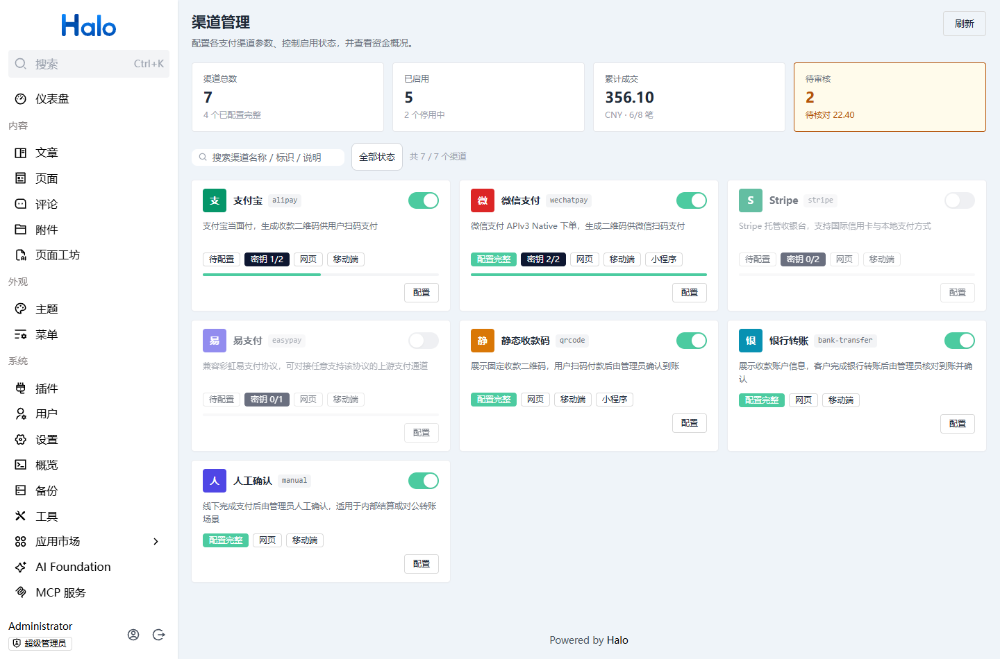
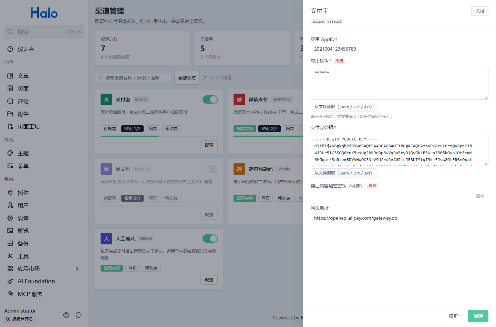
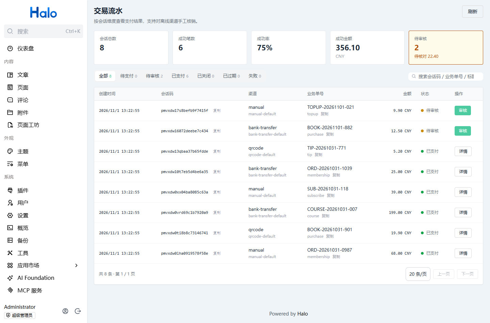
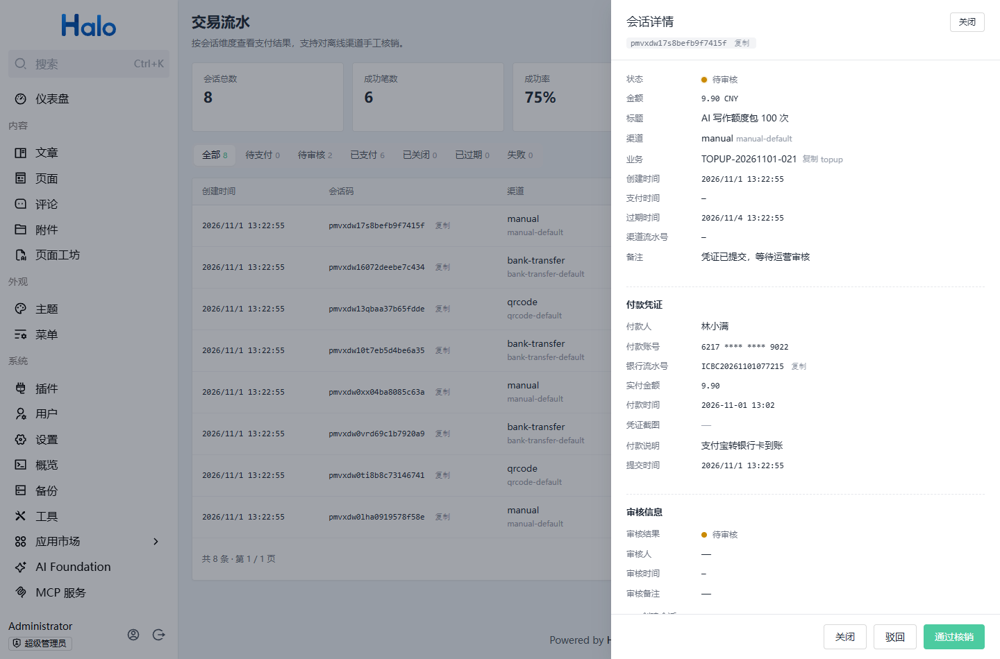

<div align="center">


# 支付中心 Payment Center

**为 Halo 2.27+ 提供开箱即用的统一支付能力**

[](LICENSE)
[](https://www.halo.run)
[](https://www.996.tax)

[仓库 Repository](https://github.com/996-dev/996-dev-payment) · [问题反馈 Issues](https://github.com/996-dev/996-dev-payment/issues) · [网站 Website](https://www.996.tax)

</div>

---

## 中文

### 简介

支付中心是一个**支付配置与收款插件**，把「发起支付 → 等待付款 → 确认到账」抽象成一条与业务无关的链路。
它不关心你在卖什么——会员、内容、商品、打赏都可以直接接入；订单状态、发货、履约由你的业务自己维护。

核心能力：

- **7 个渠道**：支付宝（当面付）、微信支付（APIv3 Native）、Stripe（Checkout）、易支付（聚合协议）、静态收款码、银行转账、人工确认
- **统一支付会话**：`bizType + bizNo` 关联业务单，幂等下单，状态机明确（`PENDING → PENDING_REVIEW → PAID` / `CLOSED` / `EXPIRED` / `FAILED`）
- **三路到账确认收敛为一个事件**：渠道回调验签、主动查单补偿、离线凭证人工核销，最终都只发一次 `PaymentSucceededEvent`
- **离线渠道内置审核流**：付款人提交凭证 → 待审核 → 后台核销/驳回（留痕：审核人、时间、依据），有效期自动顺延，不怕"钱到了单却过期"
- **密钥安全**：密钥字段落 Secret，公开配置落 ConfigMap，任何查询接口只回掩码
- **开放 API + Java 扩展点**：外部系统走 `X-API-Key` 的 HTTP 接口；Halo 插件可以直接依赖共享 API 模块调用 `PaymentGateway`，或实现 `PaymentProviderExtension` 接入任意新渠道
- **流水留痕**：下单、查单、回调、关单、凭证、审核各写一条 `PaymentTransaction`，只追加，可对账可追溯

### 界面预览

| 渠道管理 | 渠道配置 |
|---|---|
|  |  |
| **交易流水** | **离线凭证审核** |
|  |  |

### 快速开始

1. 在 [Releases](https://github.com/996-dev/996-dev-payment/releases) 下载 `pangu-payment-<version>.jar`
2. Halo 后台「插件 → 安装」上传并启用
3. 进入「支付中心 → 渠道管理」，启用并配置你要用的渠道（密钥字段支持从 `.pem/.crt/.txt` 文件直接读取）
4. 在「插件 → 支付中心 → 设置 → 接口对接」生成 API Key，业务系统凭 `X-API-Key` 调用支付接口

一条命令创建支付：

```bash
curl -X POST https://your-site/apis/api.payment.pangu.tax/v1alpha1/payments \
  -H "Content-Type: application/json" \
  -H "X-API-Key: <你的密钥>" \
  -d '{"provider":"alipay","amount":99.00,"subject":"年度会员","bizType":"order","bizNo":"ORDER-001"}'
```

### 对接方式

| 方式 | 适合谁 | 文档 |
|---|---|---|
| HTTP 开放 API | 任意语言的外部系统、前端收银台 | [docs/API.md](docs/API.md) |
| Java 扩展点（`PaymentGateway`） | Halo 插件（商城、会员、打赏…） | [docs/INTEGRATION.md](docs/INTEGRATION.md) |
| `PaymentSucceededEvent` 事件 | 所有需要"支付成功后做事"的插件 | [docs/INTEGRATION.md](docs/INTEGRATION.md) |
| `PaymentProviderExtension` 扩展点 | 想接入新渠道的插件作者 | [docs/INTEGRATION.md](docs/INTEGRATION.md) |

### 本地开发

```bash
# 后端 + 前端一体打包（需 JDK 21、Node 18+）
cd ui && npm install && npm run build && cd ..
./gradlew build          # 或使用本地 Gradle 8+
# 产物：build/libs/pangu-payment-<version>.jar
```

### 反馈与支持

- 问题与建议：[GitHub Issues](https://github.com/996-dev/996-dev-payment/issues)
- 作者：**996-dev** · 网站：<https://www.996.tax>

### 许可证

[GPL-3.0](LICENSE)

---

## English

### Introduction

**Payment Center** is a payment configuration & collection plugin for Halo 2.27+.
It turns "initiate payment → await payment → confirm settlement" into a business-agnostic pipeline:
it does not care what you sell (membership, content, goods, donations) — order state and fulfillment
stay in your own plugin or application.

Highlights:

- **7 channels**: Alipay (Face-to-Face), WeChat Pay (APIv3 Native), Stripe (Checkout), EasyPay (aggregator protocol), static QR code, bank transfer, manual confirmation
- **Unified payment session**: associate business orders via `bizType + bizNo`, idempotent creation, explicit state machine (`PENDING → PENDING_REVIEW → PAID` / `CLOSED` / `EXPIRED` / `FAILED`)
- **One event, three confirmation paths**: channel callbacks (signature verified), reconciliation queries, and manual review of offline receipts all converge into a single `PaymentSucceededEvent`
- **Built-in review flow for offline channels**: payer submits a receipt → pending review → approve/reject in the Console with full audit trail; the session expiry is automatically extended so money never "arrives after the order expired"
- **Secret safety**: secret fields go into Halo `Secret`, public settings into `ConfigMap`, and every read API returns masked values only
- **Open API + Java extension points**: external systems use HTTP with `X-API-Key`; Halo plugins can depend on the shared API module and call `PaymentGateway`, or implement `PaymentProviderExtension` to add new channels
- **Append-only ledger**: every create/query/callback/close/proof/review writes a `PaymentTransaction` record for reconciliation and auditing

### Screenshots

| Channels | Channel settings |
|---|---|
|  |  |
| **Transactions** | **Offline receipt review** |
|  |  |

### Getting Started

1. Download `pangu-payment-<version>.jar` from [Releases](https://github.com/996-dev/996-dev-payment/releases)
2. Install and enable it in the Halo Console (Plugins → Install)
3. Open **Payment Center → Channels**, enable and configure the channels you need (secret fields accept direct `.pem/.crt/.txt` file loading)
4. Generate an API key under **Plugins → Payment Center → Settings → API**, then call the payment API with the `X-API-Key` header

Create a payment in one call:

```bash
curl -X POST https://your-site/apis/api.payment.pangu.tax/v1alpha1/payments \
  -H "Content-Type: application/json" \
  -H "X-API-Key: <your-key>" \
  -d '{"provider":"alipay","amount":99.00,"subject":"Annual membership","bizType":"order","bizNo":"ORDER-001"}'
```

### Integration Options

| Option | For | Docs |
|---|---|---|
| HTTP open API | external systems in any language, checkout front-ends | [docs/API.md](docs/API.md) |
| Java extension point (`PaymentGateway`) | Halo plugins (shop, membership, tipping…) | [docs/INTEGRATION.md](docs/INTEGRATION.md) |
| `PaymentSucceededEvent` | anything that reacts to successful payment | [docs/INTEGRATION.md](docs/INTEGRATION.md) |
| `PaymentProviderExtension` | adding new payment channels | [docs/INTEGRATION.md](docs/INTEGRATION.md) |

### Building from Source

```bash
# Backend + Console UI in one jar (JDK 21, Node 18+ required)
cd ui && npm install && npm run build && cd ..
./gradlew build          # or a local Gradle 8+
# Output: build/libs/pangu-payment-<version>.jar
```

### Feedback & Support

- Issues and suggestions: [GitHub Issues](https://github.com/996-dev/996-dev-payment/issues)
- Author: **996-dev** · Website: <https://www.996.tax>

### License

[GPL-3.0](LICENSE)
