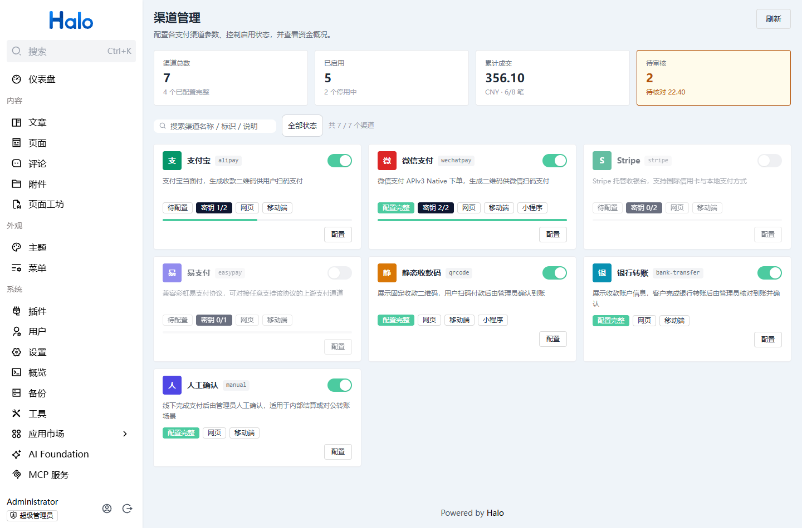
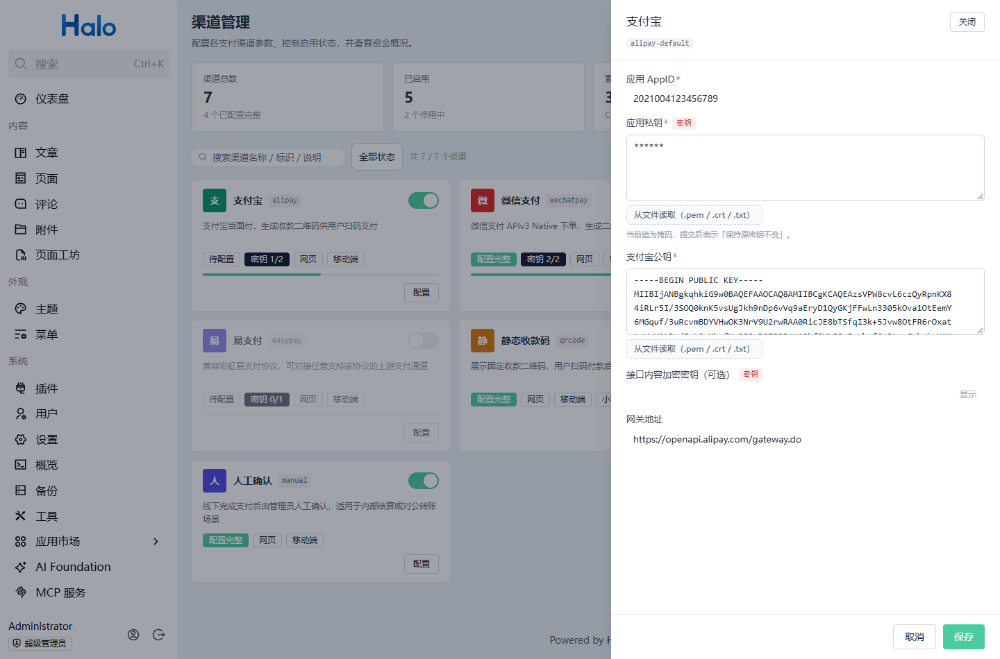
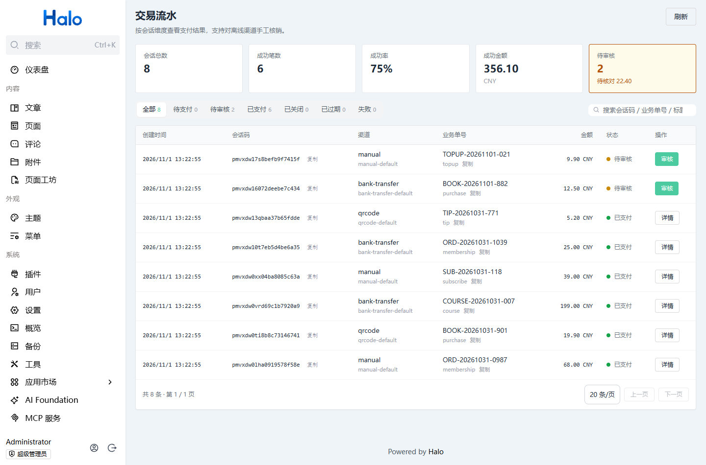
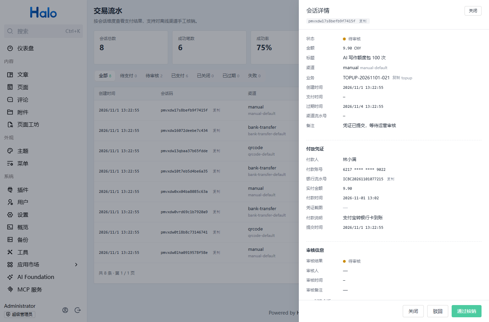

# Payment Center

[简体中文](./README.md) | English

A business-agnostic payment layer for Halo 2.27+. It covers multi-channel checkout, a payment
session state machine, manual review of offline receipts, plus an open HTTP API for external
systems and Java extension points for other plugins.



## Features

- **Seven built-in channels**: Alipay (Face-to-Face), WeChat Pay (APIv3 Native), Stripe (Checkout),
  EasyPay (aggregator protocol), static QR code, bank transfer, and manual confirmation
- **Unified payment sessions**: Associate business orders through `bizType + bizNo` with idempotent
  creation, so repeated requests return the same session instead of charging twice
- **Explicit state machine**: Transitions between `PENDING`, `PENDING_REVIEW`, `PAID`, `CLOSED`,
  `EXPIRED`, and `FAILED` are centralized in a single service and cannot be changed from outside
- **One event, three confirmation paths**: Channel callbacks with signature verification,
  reconciliation queries, and manual review of offline receipts all converge into a single
  `PaymentSucceededEvent`
- **Offline review workflow**: The payer submits a receipt, the session enters pending review, and
  an operator approves or rejects it with the operator, timestamp, and reason recorded. The expiry
  is extended after submission so money never arrives after the order has expired
- **Tiered secret storage**: Secret fields are stored in a Halo `Secret`, public settings in a
  `ConfigMap`, and every read API returns masked values only
- **Open API**: `X-API-Key` authentication, callable from any language
- **Java extension points**: Depend on the `api` module to call `PaymentGateway`, or implement
  `PaymentProviderExtension` to add your own channel
- **Append-only ledger**: Creation, queries, callbacks, closing, receipts, and reviews each write a
  transaction record for reconciliation and auditing
- **Console UI**: Built with `@halo-dev/components` and Halo design tokens, following the active
  light or dark theme

## Screenshots








## Getting Started

1. Download the plugin jar (`996-dev-payment-<version>.jar`) from
   [Releases](https://github.com/996-dev/996-dev-payment/releases), or build it yourself as
   described in the Development section
2. Upload and enable it in the Halo Console under **Plugins → Install**
3. Open **Payment Center → Channels**, enable and configure the channels you need. Private key and
   certificate fields can be loaded directly from `.pem`, `.crt`, or `.txt` files
4. Generate an API key under **Plugins → Payment Center → Settings → API**, then call the payment
   API with the `X-API-Key` header

Create a payment in one call:

```bash
curl -X POST https://your-site/apis/api.payment.pangu.tax/v1alpha1/payments \
  -H "Content-Type: application/json" \
  -H "X-API-Key: <your-key>" \
  -d '{"provider":"alipay","amount":99.00,"subject":"Annual membership","bizType":"order","bizNo":"ORDER-001"}'
```

## Integration Options

| Option | Use case | Docs |
| --- | --- | --- |
| HTTP open API | External systems in any language, checkout front-ends | [docs/API.md](./docs/API.md) |
| Java extension point `PaymentGateway` | Halo plugins such as shops, memberships, and tipping | [docs/INTEGRATION.md](./docs/INTEGRATION.md) |
| `PaymentSucceededEvent` | Plugins that react to a successful payment | [docs/INTEGRATION.md](./docs/INTEGRATION.md) |
| `PaymentProviderExtension` | Plugin authors adding a new channel | [docs/INTEGRATION.md](./docs/INTEGRATION.md) |

## Project Structure

This is a multi-module Gradle project:

| Module | Description |
| --- | --- |
| `api/` | Published Java SDK (`run.pangu.payment:api`). Other Halo plugins depend on it to call payment capabilities |
| `src/` | Plugin implementation. Contains extension definitions, channel implementations, endpoints, services, and RBAC configuration |
| `ui/` | Vue 3 + Vite console interface for channel settings and transaction management |
| `docs/` | Open API and plugin integration documentation |
| `images/` | Screenshots referenced by this README |

## Development Environment

- Java 21
- Node.js 18+
- npm
- Gradle 9.6.1 (a wrapper is bundled, no local installation needed)

## Development

```bash
# 1. Build the console assets (output goes to ui/build/dist)
cd ui && npm install && npm run build && cd ..

# 2. Build the plugin
./gradlew build

# Compile check only
./gradlew compileJava

# Run tests
./gradlew test
```

Console assets are copied into `build/resources/main/console` after `processResources` and shipped
inside the jar. When the frontend has not been built, this step is a no-op and does not affect the
backend build.

The plugin jar is written to `build/libs/`. After changing code, re-upload it in the Halo Console
under **Plugins → Payment Center**. Configuration data is preserved.

## License

[GPL-3.0](./LICENSE) © 996-dev
